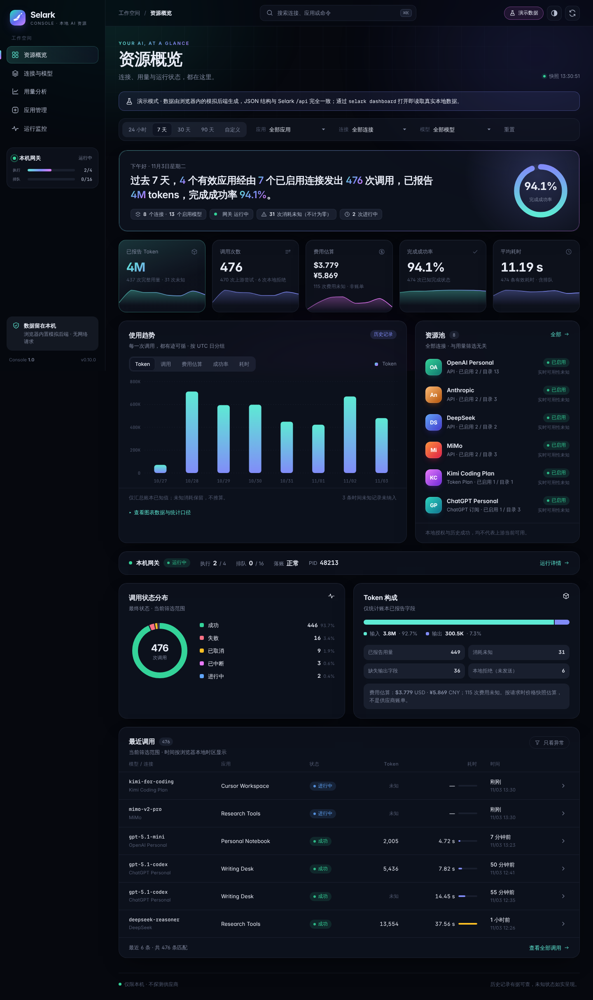
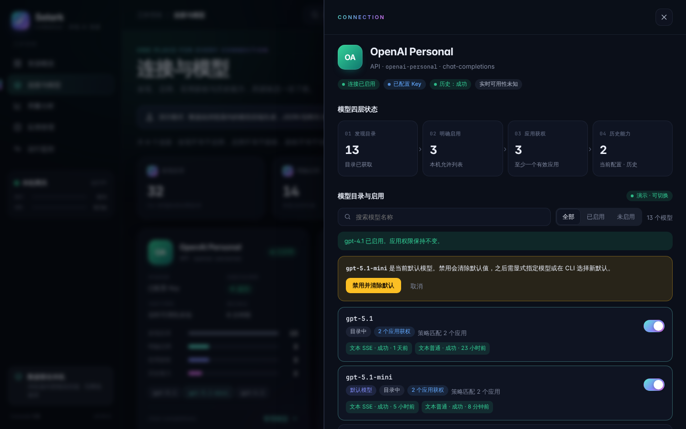
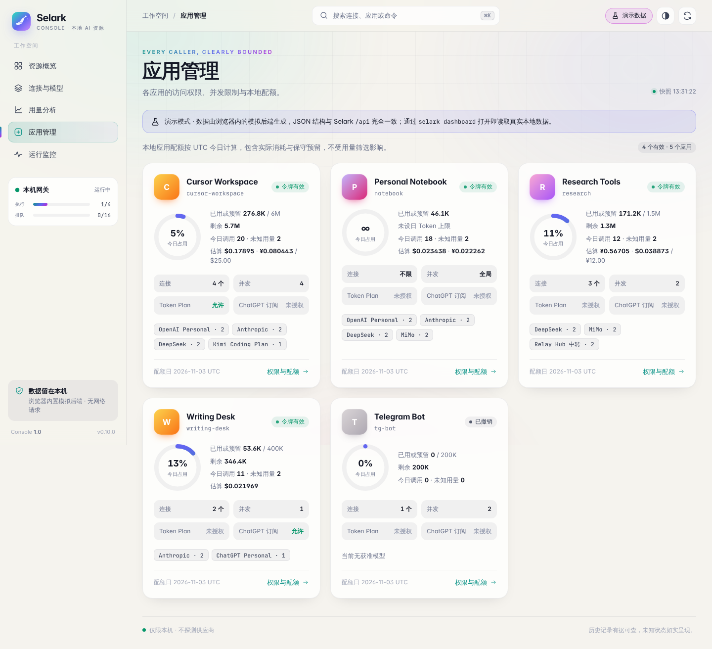

# Selark Console

为 [Selark](https://github.com/nbcctwya/Selark)（个人 AI 资源管理工具）重新设计的本地 Web 控制台。
它是 `selark dashboard` 的**直接替换前端**：读取同一套 `/api/*` 接口，遵守同样的安全边界，
同时内置一个能交互的演示后端，不装 Selark 也能直接打开浏览。



## 两种运行方式

| 模式 | 什么时候进入 | 数据来源 |
| --- | --- | --- |
| **在线模式** | 由 `selark dashboard` 在 `127.0.0.1` 上提供页面 | 真实本地账本：`/api/session`、`snapshot`、`records`、`logs`、`backups`、`model-approval` |
| **演示模式** | 直接打开 `index.html`、部署在任意静态服务器、地址带 `?demo`，或在登录页点“浏览演示数据” | 浏览器内的模拟后端：约 4,800 条、92 天的合成调用，JSON 结构与 Selark 的投影完全一致 |

### 直接看演示

```bash
cd selark-console && python3 -m http.server 8000
# 打开 http://localhost:8000/
```

也可以直接双击 `index.html`（file:// 下自动进入演示模式）。

### 装进 Selark

```bash
./install.sh                       # 自动找到 pipx 安装的 selark，备份原版后替换前端
selark dashboard                   # 照常启动，终端里的一次性链接会打开新界面
./install.sh --restore             # 恢复原版前端
```

也可以把路径传进去：`./install.sh /path/to/site-packages/selark/dashboard_assets`。
文件名与原版一一对应（`index.html`、`app.js`、`style.css`、`mark.svg`），所以不需要修改
`dashboard.py` 的资源白名单。`pipx reinstall` / `upgrade` 之后要重新执行一次 `install.sh`。

## 页面

- **资源概览**：一句话总结当前时段；带迷你趋势图的 5 个指标卡（Token、调用、费用、成功率、耗时）；
  可悬停查看的每日趋势图（5 种指标可切换）；资源池；本机网关状态条；状态分布环形图；Token 构成；最近调用。
- **连接与模型**：“发现 → 启用 → 应用获权 → 历史能力”四层汇总，每个连接一张卡片，含四层漏斗与套餐窗口。
  侧边抽屉里可搜索、筛选模型，用开关**启用 / 禁用**模型（禁用默认模型时需二次确认；遇到 409 版本冲突会自动刷新并提示）。
- **用量分析**：24h / 7 / 30 / 90 天或自定义时段，按应用 / 连接 / 模型交叉筛选；模型排行、状态分布、分页调用记录、只看异常。
- **应用管理**：每个调用方的今日配额环、预算估算、策略（连接、并发、Token Plan、ChatGPT 订阅）与获准资源。
- **运行监控**：执行并发 / 等待队列仪表盘、落账状态、异常调用、结构化日志时间线、本地备份清单。
- **调用详情**：耗时构成（排队与上游）、上游 → 交付 → 最终状态的流转、用量与费用口径、错误代码。

其他体验：深色 / 浅色 / 跟随系统三种主题，`⌘K` / `Ctrl+K` 命令面板（跳页面、找连接或应用、执行操作），
键盘快捷键 `1–5` 切换页面、`R` 刷新、`/` 搜索；手机上自动换成底部标签栏。

| | |
| --- | --- |
|  |  |

## 与 Selark 保持一致的地方

- **安全边界不变**：从 `#login=` 兑换一次性凭证后立即清除 URL 片段；会话只存在按 origin 隔离的
  `sessionStorage`，通过 `X-Selark-Session` / `X-Selark-Dashboard` 请求头显式发送；`credentials: "omit"`、
  `mode: "same-origin"`、`redirect: "error"`；只有主题偏好写入 `localStorage`。
- **兼容 Selark 的 CSP**（`script-src 'self'; style-src 'self'; img-src 'self'`）：没有内联脚本或样式、没有
  `data:` URI、没有 CDN 或外部字体。动态尺寸和颜色通过 CSSOM 写入 CSS 自定义属性。
- **统计口径照搬**：未知值显示为“未知 / —”，不按零计算；费用按币种分别展示并注明“非账单”；
  成功率分母为成功 + 失败 + 取消 + 中断；趋势按 UTC 日分组；本地授权或历史成功都不等于实时可用。
- **只读与可写的边界**：快照里 `capabilities.model_approval` 为 false（`--read-only`）时隐藏所有开关；
  启用 / 禁用请求带上 `revision` 与 `clear_default`，和原版完全一样。
- 所有来自账本的文本在渲染前都会做 HTML 转义。

## 验证情况

- 用 headless Chromium 在 Selark 的 CSP 响应头下检查了所有页面、抽屉、命令面板和登录页：
  深色、浅色和 390px 手机宽度下都没有控制台错误、没有 CSP 拦截、没有横向溢出。
- 在演示模式下实际操作了模型启用、默认模型禁用确认和记录详情。
- 用一个复制出来的 `dashboard_assets` 目录测试了 `install.sh` 的安装与恢复。
- **在线模式还没有和正在运行的 Selark 实例联调过**。它的请求逻辑是按 `dashboard.py` 和
  `dashboard_data.py` 的接口逐项对照原版前端写的。第一次在真实账本上使用时，建议先跑
  `selark dashboard --read-only` 看一遍。

## 文件

```
selark-console/
├── index.html          页面骨架（无内联脚本 / 样式）
├── assets/app.js       在线 API 客户端 + 演示后端 + 全部渲染逻辑（无依赖）
├── assets/style.css    设计系统：极光深色 / 暖纸浅色两套 token
├── assets/mark.svg     新标识
├── install.sh          安装到已装的 Selark / 一键恢复
└── docs/               预览截图
```
